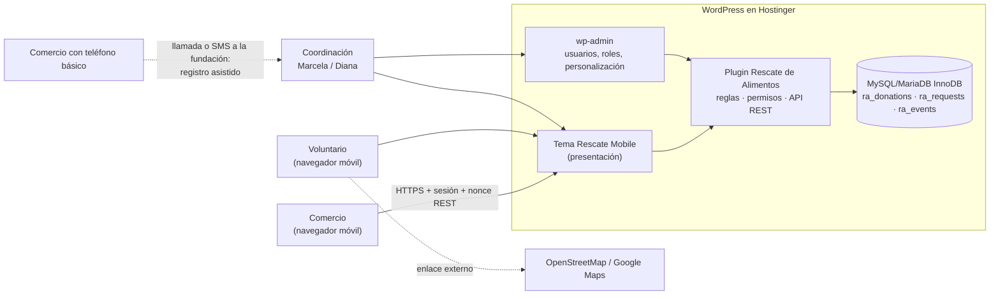

# ADR-001 · Cambio de plataforma: de Bubble + WhatsApp Business a WordPress (plugin + tema)

| Campo | Valor |
|---|---|
| **Estado** | Aceptada · reemplaza la decisión de plataforma de `docs/spec/plan_tecnico.md` (sección 1, Alternativa C) |
| **Fecha de la decisión** | Entre el 10 y el 27 de octubre de 2026 |
| **Fecha de este registro** | 10 de noviembre de 2026 |
| **Decidida por** | Equipo completo |
| **Autor del registro** | Diego Hernandez |
| **Proyecto** | Rescate de Alimentos · Fundación Mesa Común · Proyecto Informático 2 |

---

## 1. Contexto

### 1.1 Lo que se había decidido

En el Módulo 2 se compararon tres alternativas con una matriz ponderada y se eligió la **Alternativa C**:

| Alternativa | Descripción | Puntaje M2 |
|---|---|---|
| A | Aplicación web progresiva (PWA) | 107 / 130 |
| B | App nativa con microservicios | 56 / 130 |
| **C** | **Plataforma No-Code/Low-Code (Bubble) + API oficial de WhatsApp Business** | **119 / 130** |

El plan técnico del 10 de octubre (`docs/spec/plan_tecnico.md`) describía esa arquitectura: los actores interactúan por WhatsApp, Meta envía un webhook a Bubble, Bubble guarda los datos, ejecuta las automatizaciones (ofertas a voluntarios, reintentos, expiración a los 15 min) y ofrece un panel a Marcela y Diana.

### 1.2 Lo que cambió después de esa decisión

1. **El alcance del MVP se redujo a cinco comportamientos.** La Entrega 3A (v1.0, 7 de octubre) y la especificación `docs/spec/comportamientos.md` fijaron el núcleo evaluable en: registrar una donación, ver las disponibles vigentes, reservarla de forma exclusiva, registrar la entrega y consultar su estado por identificador. Ninguno de los cinco exige WhatsApp; la mensajería y los informes quedaron **fuera del núcleo** (`docs/REQUISITOS-MVP.md`, «Outside current core»).
2. **La reserva exclusiva pasó a ser el criterio crítico.** CMP-03 exige que, si dos voluntarios reservan al tiempo, haya exactamente un ganador y un conflicto claro, y que un reintento no duplique la reserva. Eso requiere una operación atómica en la capa de datos y claves de idempotencia. El propio plan técnico condicionaba la alternativa a «demostrar exclusión de reservas» y dejaba Bubble y Airtable «como opciones de evaluación, no como una arquitectura ya implementada» (`docs/plan/plan-tecnico.md`, rama `origin/samuel_moreno`).
3. **El canal WhatsApp tenía dependencias externas con plazos que el equipo no controlaba**: verificación de la cuenta Meta Business, un número nuevo dedicado y aprobación de plantillas (el plan técnico advertía que «puede tardar días»). *[CONFIRMAR si alguno de estos trámites llegó a iniciarse o quedó bloqueado.]*
4. **Se requería una URL desplegada y verificable por otra persona** antes del corte del 29 de octubre (Entrega 3B).

### 1.3 Restricciones que se mantienen del contexto original

- Presupuesto operativo de la fundación ≤ $150.000 COP/mes.
- La fundación debe poder administrar el sistema sin personal de TI.
- Usuarios con teléfonos de gama baja, conectividad intermitente y ventanas cortas de recogida.
- Comercios con teléfono básico: deben poder ser atendidos por registro asistido (HU-13).
- Tratamiento de datos conforme a la Ley 1581 de 2012.

---

## 2. Impulsores de la decisión

| # | Impulsor | Peso |
|---|---|---|
| D1 | Cumplir los 5 comportamientos del núcleo, en especial la reserva exclusiva con evidencia | Crítico |
| D2 | Tener una aplicación desplegada y verificable antes del corte de la Entrega 3B | Alto |
| D3 | No depender de aprobaciones de terceros (Meta) para que el flujo principal funcione | Alto |
| D4 | Costo mensual dentro del presupuesto de la fundación | Alto |
| D5 | Que Marcela y Diana puedan administrar usuarios, marca y textos sin programar | Medio |
| D6 | Código versionable en GitHub, revisable por PR | Medio |
| D7 | Funcionar bien en un móvil de gama baja (360 px) | Medio |

---

## 3. Alternativas consideradas en esta revisión

### Opción 1 · Mantener Bubble + WhatsApp Business (Alternativa C original)

- **A favor:** coincide con el canal que ya usan los actores; nadie instala ni inicia sesión; fue la mejor calificada en el Módulo 2.
- **En contra:** la reserva atómica no se había demostrado en Bubble y su control fino de concurrencia es limitado; el flujo principal quedaba sujeto a verificación de Meta y aprobación de plantillas; la lógica vive en un editor visual que no se versiona en Git, lo que dificulta revisar los cambios por PR; costo en dólares (~US$30 + mensajes) con margen estrecho frente al tope.

### Opción 2 · PWA a medida (Alternativa A del Módulo 2)

- **A favor:** control total de la lógica y de la concurrencia; buena experiencia móvil.
- **En contra:** hay que construir desde cero autenticación, roles, panel de administración y despliegue; mayor esfuerzo y mantenimiento para un equipo pequeño y una fundación sin personal técnico.

### Opción 3 · WordPress con plugin propio + tema móvil (opción elegida)

- **A favor:** WordPress ya resuelve autenticación, roles, sesiones, nonces y panel de administración; el plugin permite escribir la reserva como una operación SQL atómica con transacción en InnoDB; se despliega en hosting compartido económico; todo el código queda en GitHub; la fundación administra desde el escritorio de WordPress.
- **En contra:** se pierde el canal WhatsApp como interfaz principal; los actores deben iniciar sesión en una web; requiere actualizar WordPress y el plugin periódicamente.

### Comparación frente a los impulsores

| Impulsor | Bubble + WhatsApp | PWA a medida | **WordPress** |
|---|---|---|---|
| D1 Núcleo y reserva exclusiva | Sin demostrar | Posible, todo por construir | **Demostrado (10 carreras, 1 ganador)** |
| D2 Desplegado antes del corte | En riesgo por Meta | En riesgo por esfuerzo | **Desplegado el 27-oct** |
| D3 Sin aprobaciones externas | No | Sí | **Sí** |
| D4 Costo | ~$130–145 mil COP/mes | Hosting + mantenimiento | **Hosting compartido** *[CONFIRMAR valor del plan Hostinger]* |
| D5 Administración sin programar | Sí (Bubble) | No (hay que construirla) | **Sí (wp-admin + pantalla Personalización)** |
| D6 Código en Git y pruebas | Limitado | Sí | **Sí (código y pruebas en el repositorio)** |
| D7 Móvil gama baja | Sí (WhatsApp) | Sí | **Sí, verificado a 360 px** |

> Nota: la matriz del Módulo 2 se mantiene como evidencia histórica. Esta tabla no la recalifica; compara las opciones contra los impulsores que surgieron **después** de que se acotó el MVP.

---

## 4. Decisión

Se construye el MVP como un **plugin de WordPress (`rescate-alimentos`) más un tema móvil (`rescate-mobile`)**, alojado en Hostinger, y se **abandona Bubble y la integración automática con WhatsApp Business** para esta entrega.

La decisión se toma porque el núcleo evaluable ya no depende de WhatsApp, y la plataforma elegida permite demostrar la reserva exclusiva, desplegar sin aprobaciones de terceros y dejar el código revisable en el repositorio.

---

## 5. Arquitectura resultante

| Elemento del plan original | Cómo queda en WordPress |
|---|---|
| Interfaz WhatsApp con botones | Webapp móvil (tema + shortcode `[rescate_app]`) |
| Base de datos de Bubble | Tablas propias `ra_donations`, `ra_requests`, `ra_events` en InnoDB |
| Identificación por número de teléfono | Cuentas de WordPress con roles Comercio donante, Voluntario y Coordinación; sin registro público |
| Oferta automática al primer voluntario | El voluntario consulta las disponibles y reserva; `UPDATE … WHERE status='available' AND volunteer_id IS NULL AND deadline > ahora` garantiza un solo titular |
| Deduplicación por `wamid` | Clave de idempotencia por solicitud en `ra_requests` |
| Bitácora de Eventos | `ra_events`: actor, momento, estado anterior → nuevo |
| Registro asistido HU-13 | Coordinación registra a nombre del comercio con autor, canal (llamada/SMS) y origen «Asistido» |
| Panel de Bubble | wp-admin y pantalla **Rescate de Alimentos → Personalización** |
| Enlace de mapa | Pin opcional + OpenStreetMap (Leaflet) y enlace a ruta en Google Maps |

---

## 6. Consecuencias

### Positivas

- El núcleo se ejecuta en la aplicación desplegada: registro, listado filtrado, reserva, entrega con fecha, hora y responsable, y consulta por identificador.
- La reserva exclusiva tiene evidencia: 10 carreras HTTP con dos usuarios dan siempre un 200 y un 409 (`tests/results-race.json`).
- Sin dependencia de Meta: no hay plantillas que aprobar ni números que verificar para operar.
- El código, las pruebas y los paquetes instalables están en GitHub y se revisan por PR.
- La fundación gestiona usuarios, logotipo, colores y textos sin tocar código.

### Negativas y riesgos aceptados

| Se pierde o se asume | Mitigación |
|---|---|
| WhatsApp deja de ser el canal; los actores deben aprender a usar una web e iniciar sesión | Interfaz móvil sencilla, cuentas creadas por la fundación, registro asistido para quien no pueda usarla |
| No hay informes para cooperantes | Fuera del núcleo; candidato a siguiente iteración |
| Mantenimiento de WordPress (actualizaciones, seguridad) | Respaldo antes de actualizar, procedimiento en `docs/ARCHITECTURE.md` |
| La concurrencia se probó en SQLite/Playground, no en InnoDB del hosting | Prueba pendiente de 10 carreras en el hosting |
| Datos alojados en Hostinger | Informar en la política de tratamiento de datos (Ley 1581) |

### Documentos afectados

- `docs/spec/plan_tecnico.md`: queda como antecedente; las secciones 1, 2, 4 y 5 ya no describen el sistema construido. Se debe añadir al inicio una nota que remita a este ADR.
- `README.md` de `main`: aún describe la solución No-Code + WhatsApp; se debe actualizar al integrar `develop`.

---

## 7. Cuándo revisar esta decisión

Se reabrirá si ocurre alguno de estos casos:

- La fundación exige que la interacción principal vuelva a ser por WhatsApp. En ese caso, la integración se haría **sobre** el plugin (webhook de Meta → API REST de WordPress), sin reemplazar la plataforma.
- La prueba de concurrencia en InnoDB del hosting falla.
- El costo del hosting supera el presupuesto mensual de la fundación.

---

## 8. Evidencia

| Evidencia | Ubicación |
|---|---|
| Plan técnico original (Bubble + WhatsApp) | `docs/spec/plan_tecnico.md` (commit `0a0818c`, 10-oct-2026) |
| Matriz de alternativas del Módulo 2 | Enlace SharePoint en `docs/spec/README-antecedentes.md` |
| Primer código WordPress en el repositorio | Commit `283eb83`, 29-oct-2026, rama `feature/wordpress-plugin` |
| Arquitectura del MVP | `docs/ARCHITECTURE.md` |
| Despliegue verificado | `docs/DESPLIEGUE.md` · https://lightgreen-echidna-927363.hostingersite.com/ |
| Pruebas de carrera y núcleo | `tests/results-race.json`, `tests/results-local.json` |
| Recorrido de tres perfiles en el hosting | `tests/results-hosting-v2.json` |
